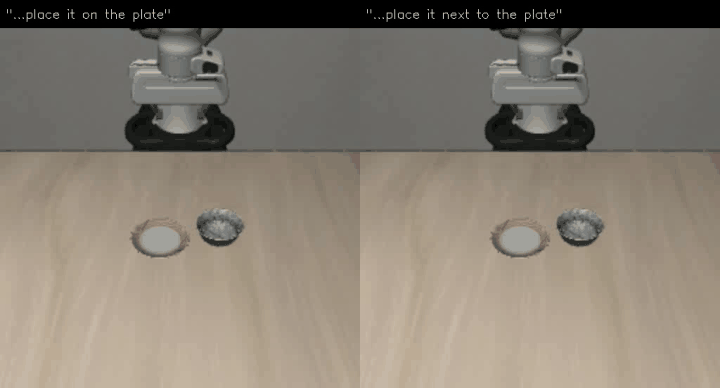
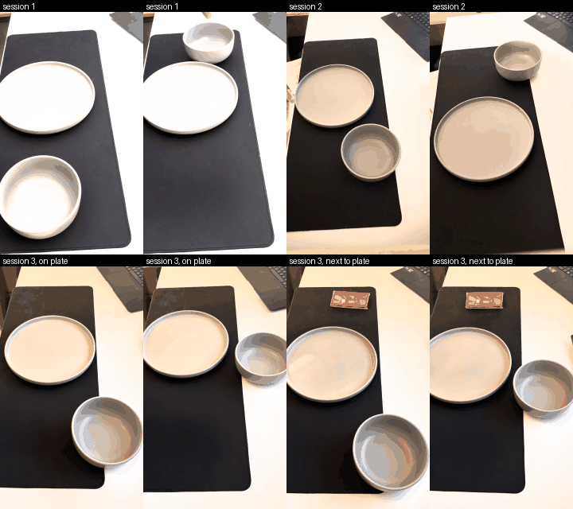
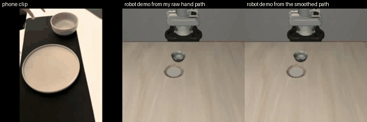
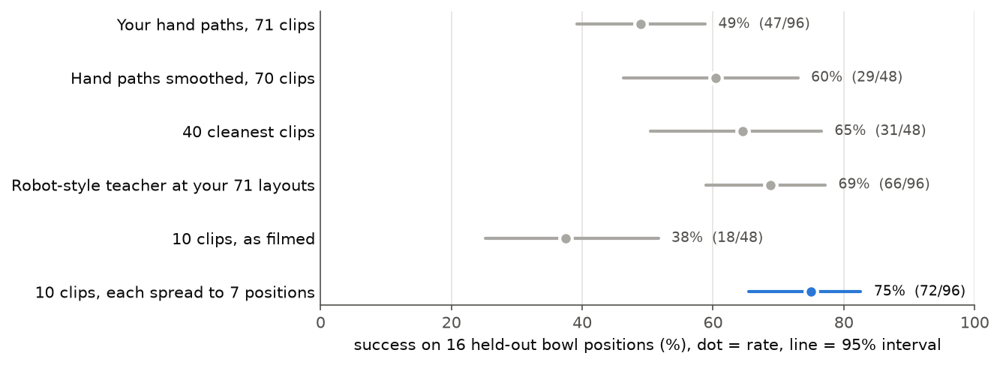
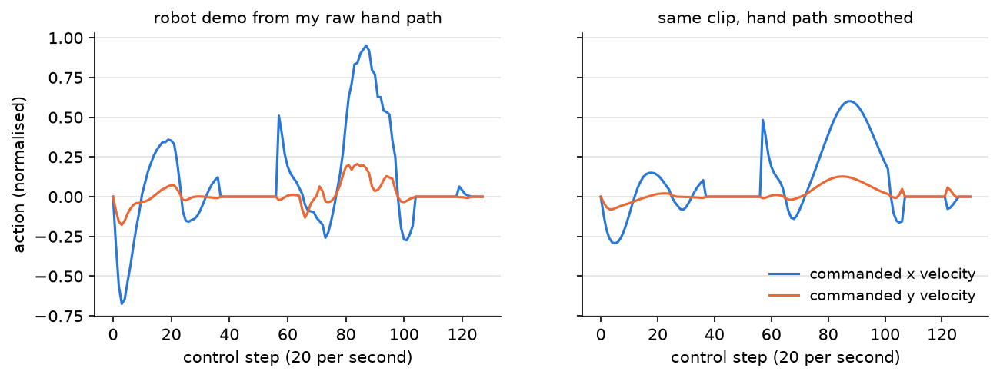
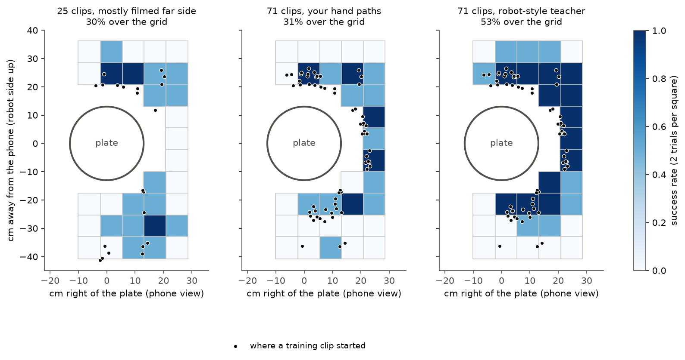
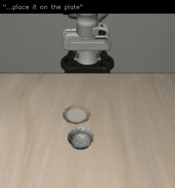
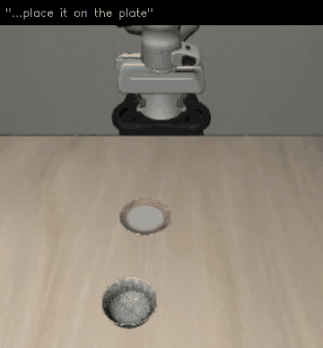
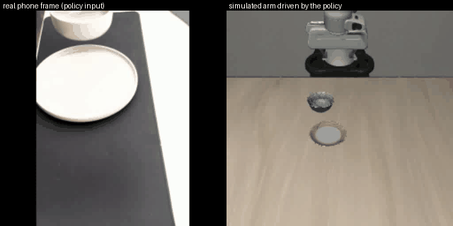

# What should a robot copy from a phone video?

I filmed myself putting a bowl on a plate about 200 times with my phone, turned those clips into training data for a
simulated Panda arm in LIBERO, and fine-tuned SmolVLA on it. My clips are the only source of training data: every
bowl position the robot trains and is tested on comes from a real clip, and both of the behaviours below were taught
by filming them. Along the way I kept asking which parts of a human video are actually useful to a robot policy.



*One trained model, one scene it has never seen. Left: "pick up the black bowl and place it on the plate". Right:
"...place it next to the plate". Both behaviours come from my phone clips.*

## The idea

A robot cannot copy a phone video directly. My hand is not a gripper, and a video has no robot actions in it, which is
what a policy needs to learn from. So the real question is what a human video contains that a robot can use. I think
there are three candidates:

1. **Where things are**: where the bowl starts, where it ends up, which side I grab it from.
2. **How my hand moves**: the shape and timing of the path.
3. **What it looks like**: the raw pixels.

I built a pipeline that can use each of these separately, so I could measure how much each one is worth on its own.

## Summary

- **Best policy: 75% success on bowl positions it never saw**, trained on just 10 of my clips that the simulator
  spreads out to nearby positions. The same 10 clips used as filmed give 38%.
- **The robot learns where things are from my videos, not how my hand moves.** On the same bowl positions, a plain
  robot-style motion beats my own hand paths, 69% to 49%. Success follows where I filmed.
- **Language only matters once the data needs it.** Trained on one sentence, the model breaks when the sentence is
  reworded. Trained on two jobs in the same scenes, it picks the right job from the instruction and never did the
  wrong one in 72 tests.
- **Feeding the raw phone frames to the policy does not work here (2%),** and I can show why.

## How I got here

I did not plan these experiments up front. Each one came from something in the previous result that surprised me.

1. **First version.** Phone clip to hand path to robot demo to SmolVLA. It worked, and more clips helped:
   6 clips gave 8%, 12 gave 25%, 25 gave 50%.
2. **Was my data actually doing anything?** As a control I trained on 14 demos from a simple script with no human
   motion at all, and it did about as well. Looking closer, my clips were all filmed on one side of the plate, so I
   filmed more around the rest of the table.
3. **A fair test of my hand motion.** Same 71 bowl positions, once following my hand and once with the script. The
   script won. Smoothing my paths and keeping only my cleanest clips barely helped. So my hand motion is not the
   useful part; the positions are.
4. **If positions are what matter, the simulator should be able to fill them in.** I took 10 clips and replayed each
   one at 7 nearby positions. Success went from 38% to 75%.
5. **I wanted the policy to see my real video, not just the simulator.** I trained it on the actual phone frames. It
   failed, and working out why taught me what the label needs to be.
6. **I noticed the robot never recovers from a bad grasp,** so I added demos with random pushes (DART-style).
   Replacing clean demos with them hurt; adding them did not.
7. **Does it even read the instruction?** Not really: with one task, the text never carried any information. So I
   filmed a second job in the same setup, and the model started choosing between them from the instruction.

## The data

195 clips over three sessions, filmed with my phone propped up on the desk: a 26 cm plate, a 15 cm bowl, and a black
mat. In sessions 1 and 2 I moved the bowl from different starting spots onto the plate. In session 3 I filmed a second
job as well: the same starting spots, but the bowl goes onto a marker next to the plate instead.



A few full clips are in [media/clips](media/clips). The processed version of every clip (hand path, grasp and release
frames, bowl start) is in [data](data).

## How it works

```
phone clip --> hand tracking --> grasp/release + hand path --> plate-relative cm --> robot demo in LIBERO --> SmolVLA
  (.MOV)        (MediaPipe)       (pinch signal)               (plate = ruler)       (scripted arm follows     (fine-tune,
                                                                                    my path and timing)      closed-loop test)
```



1. **Hand tracking.** MediaPipe gives 21 hand keypoints per frame. The point between thumb and index fingertip
   stands in for the gripper, and the thumb-index distance divided by hand size gives a pinch signal that does not
   depend on how far the hand is from the camera. The longest stretch of closed pinch is the grasp.
2. **The plate is the ruler.** I propped the phone up by hand and it moved between sessions, so there is no fixed
   camera calibration. Instead I fit an ellipse to the plate (26 cm) in every clip. That gives the scale in both image
   directions and an origin, so every clip ends up in the same plate-relative centimetres.
3. **Bowl start.** The biggest region that changed between the first and last frame, outside the plate.
4. **Robot demo.** A custom LIBERO scene with only the plate and a bowl, scaled by 0.65 to fit the Panda's reach. A
   position controller that knows the true object positions follows the shape and timing of my hand path, grasps the
   rim on the side my hand went for, and places the bowl. The simulator records images, robot state and actions.
5. **Policy.** SmolVLA (450M) fine-tuned from `lerobot/smolvla_base` for 6000 steps at batch 16, about 2 hours on a
   laptop RTX 4060. It executes 10 of every 50 predicted actions before re-planning.
6. **Evaluation.** 16 bowl positions taken from clips held out of training, 3 runs each (48 episodes), with the policy
   in control the whole time and LIBERO checking success.

## Design choices

- **Going through the simulator instead of training on the video directly.** The policy has to output robot actions,
  and my clips have none. The simulator turns each clip into a robot demonstration that keeps what the clip contains
  (where the bowl is, which side I grab, the path and its timing) and adds what it is missing (actions the Panda can
  actually execute). I also tried skipping this step (result 4).
- **A teacher that knows where the objects are.** The controller that makes the demos reads the true bowl and plate
  positions from the simulator. That keeps perception out of the question: the only thing that changes between my
  experiments is what is taken from my clips. The policy itself only ever sees camera images and the robot's own state.
- **Plate-relative coordinates.** I filmed in three sessions with the phone in slightly different places. Measuring
  everything from the plate made the clips comparable without any camera calibration.
- **SmolVLA.** It is small enough to fine-tune on an 8 GB laptop GPU, it is a real vision-language-action model (so
  the language experiments mean something), and LeRobot supports it with LIBERO out of the box.
- **Test positions from my own held-out clips.** The robot is tested on situations that I actually produced when
  filming, not on positions I picked to make it look good. Every model is tested on the same 16 positions.
- **Closed-loop testing.** The policy controls the arm for the whole episode and has to live with its own mistakes,
  which is where imitation learning usually breaks.

Before trusting any number I checked the evaluation code: the public `smolvla_libero` checkpoint scores 7/8 on an
original LIBERO task through it, and 0/24 on my scene (as does `smolvla_base`). So the task is new to the model, and
everything below is learned from my data.

### How to read the numbers

With 48 to 96 test episodes per model, every success rate has some luck in it. So next to each comparison I give a
**95% range**: the range the true difference most likely falls in if I repeated the whole experiment. If the whole
range is above zero, the difference is real and not luck. If it crosses zero, I cannot tell the two models apart, and
I say so. Episodes at the same bowl position are not independent, so the range is computed by resampling test
positions, not single episodes.

## Results

All rows use the same 16 held-out positions. Dot is the success rate, line is its 95% range.



### 1. Copy the layout, not the hand

Same 71 bowl positions from my clips, once with demos that follow my hand and once with a plain robot-style teacher
(straight paths, fixed timing). The only difference is the motion.

| Training data (71 positions, 2 training runs each) | Success |
|---|---|
| Robot demos following my hand paths | 49% (47/96) |
| Robot-style teacher at the same positions | 69% (66/96) |

The robot-style teacher is 20 points better (95% range +4 to +34, so not luck). It wins at 9 of the 16 test positions
and loses at 1. Cleaning up my motion helped a little but did not close the gap. My hand path looks fine as a path, but
tracking jitter of a few millimetres per frame turns into spiky velocity commands once the robot follows it, and those
commands are exactly what the policy has to learn to imitate:



Smoothing the paths raised success to 60%, and keeping only my 40 cleanest clips gave 65% (against 63% for 40 random
clips). These gains are real in direction but small next to the noise, and neither reaches the robot-style teacher.

Why would a plain script beat a real human? In this task the path carries no information: any reasonable path to
the plate works. So the variety in my 71 paths is not useful variety, it is noise. The policy sees nearly the same
image in two demos and is told to move in two different ways, and it ends up averaging them. The script gives one
consistent answer for every situation. I would expect this to flip for a task where the path matters, like carrying
the bowl around an obstacle.

What my videos do provide is the situations. The heatmaps test each model over a grid of bowl positions; black dots
are where training clips started. The first model, trained on 25 clips I had mostly filmed on the far side of the
plate, only works near those clips.



Each square is a starting position for the bowl, darker means more successful. The models are good where I filmed
and fail where I did not, whatever the motion. The third panel is better everywhere because its demos are consistent,
but it still fades away from the dots.

This matches recent work that transfers what happens to the object rather than what the hand does (HumanEgo,
Im2Flow2Act), and the finding that variety of situations matters more than the number of demos (Data Scaling Laws in
Imitation Learning).

### 2. Ten clips, spread out by the simulator

If a clip is mostly useful for where it happened, the simulator should be able to fill in the space around it. I
picked 10 clips spread over the table and replayed each at its filmed position plus 6 nearby ones (3 to 12 cm away,
same hand path re-targeted to the new start).

| Training data | Success |
|---|---|
| 10 clips, as filmed | 38% (18/48) |
| 10 clips x 7 positions (2 training runs) | **75% (72/96)** |
| 71 clips, robot-style teacher (2 training runs) | 69% (66/96) |

Spreading adds 38 points (95% range +21 to +54). Ten spread clips are as good as the best 71-clip model (the 6-point
gap is within the noise, range -5 to +19). This is the same idea as MimicGen and Real2Render2Real, here with my own
phone clips. A possible extra reason: 10 distinct hand motions are more consistent training targets than 71 different
ones.

Why it works: to grab the bowl, the policy has to learn "see the bowl here in the image, move there". Each real clip
shows that for one position. Spreading a clip shows the same grasp and the same motion for several nearby positions,
so the gaps between my clips get filled in. In practice it means a few carefully filmed clips plus simulation can
replace a lot of filming.

| Success | Failure |
|---|---|
|  |  |

Most failures are bowls that start far from the robot, near the edge of its reach.

### 3. Language only matters once the data needs it

All the models above were trained on one sentence. I tested the 40-clip model (65% with its training sentence) with
other instructions:

| Instruction at test time | Success |
|---|---|
| pick up the black bowl and place it on the plate (training sentence) | 65% |
| place the bowl on the plate | 21% |
| move the bowl onto the plate | 25% |
| put the bowl onto the plate | 31% |
| move the bowl away from the plate | 29% |
| pick up the plate and put it on the bowl | 56% |
| pick up the cup and put it on the plate | 56% |
| open the top drawer of the cabinet | 17% |

Rewordings with the same meaning hurt more than sentences with a different meaning that look similar. The model
reacts to the form of the sentence, not what it says. This makes sense once you think about training: the sentence
was the same in every single demo, so it never helped predict anything. The model learned the task from the images,
and a new sentence is just an unfamiliar input that throws it off.

The fix is to make the sentence matter: the same scene has to call for different actions depending on the
instruction. Then the only way to get the training examples right is to read the words.

So I filmed a second job in the same setup: putting the bowl on a marker next to the plate instead of on it (42 clips
of the first job and 35 of the second, same session, same starting positions). I trained one model on both, with the
two sentences differing only in their last words, and tested it on 18 held-out scenes with each instruction:

| Asked for | Bowl on the plate | Bowl next to the plate | Neither |
|---|---|---|---|
| "...on the plate" | **19/36** | 0/36 | 17/36 |
| "...next to the plate" | 0/36 | **27/36** | 9/36 |

In 72 episodes it never did the wrong job; when it fails, it just does not finish. This lines up with LIBERO-CF
(When Vision Overrides Language), which finds that VLAs only follow the instruction when the scene alone does not
tell them what to do.

### 4. What did not work

**Raw video frames.** This is the most direct use of a video, so I wanted to try it: no hand tracking, no
retargeting, just my real frames in and gripper positions out. I trained SmolVLA on my phone frames, each paired with
where the robot's gripper is at that moment in the demo made from the same clip, and then drove the simulated arm with
it.



It succeeded once in 48 episodes. Its targets were 6.6 cm off on average, and a grasp
needs about 1 cm. Even replaying the perfect labels only works 6 times out of 16, because the label is an absolute
position and the simulator places the bowl slightly differently every time (14/16 when I reuse the exact same
placement). Two things go wrong at once. The policy never sees the simulator, so it cannot correct anything: it
plays the video and hopes the arm is in the right place. And it has to guess absolute positions from a real image
taken by a phone that moved between sessions. Methods that make this work change the input or the label, for example
painting a robot over the hand (Phantom) or predicting tracks in the image (MT-pi).

**Recovery data.** The robot never recovers from a missed grasp, because every demo it saw was perfect. It has never
seen the arm in the wrong place and what to do about it. So I made demos where the arm is pushed randomly while it
moves, and the recorded action is the controller's correction back to the plan (the idea behind DART).

| Training data (40 clips) | Success |
|---|---|
| Clean demos | 65% |
| Pushed demos replacing the clean ones | 46% |
| Clean + the same demos again (2 training runs) | 53% |
| Clean + pushed demos | 71% |

Replacing clean data with pushed data hurts. Adding pushed demos beats adding plain copies of the same size
(+18 points, range +7 to +28), but it does not clearly beat the clean set alone. My guess for why replacing hurts:
SmolVLA predicts 50 actions at a time, and after random pushes the future actions in a demo depend on pushes that
have not happened yet, so they are partly unpredictable. Mixing in clean demos keeps enough predictable examples.

**Clutter.** A second object in the scene drops success from 65% to 31% (a ramekin or a second bowl) or 52% (a box
of cookies), even though the robot almost never touches it. I did not train with clutter.

**Re-planning rate.** Executing 1, 5, 10, 25 or 50 of the predicted actions before asking the model again gives 52%,
58%, 65%, 63% and 44%. Ten works best for this task.

## What I learned

- A human video is not one thing. In this task its value was almost all in the situations it shows, and very little
  in how my hand moved. I did not expect that going in.
- More data was not always better. 10 clips used well beat 71 clips used directly.
- A model only uses the parts of its input that the training data forces it to use. That was true for the language
  and, in a way, for the hand motion too.
- Checking the evaluation first, and comparing models on exactly the same test positions, saved me from believing
  several differences that turned out to be noise.

## Limitations

- One simple task, in simulation, with a scripted teacher that knows the true object positions. A real robot would
  need those positions from perception.
- With 48 to 96 episodes per model I can only reliably see differences of about 20 points or more; smaller ones in
  this README are marked as within the noise.
- The two-instruction result is a single training run.
- I scaled the table by 0.65 to fit the arm, so distances in the simulator are not my real ones.

## What I would try next

- Train with clutter and pushed demos together, on top of the spread-out clips.
- A task where the hand's path itself matters, for example carrying around an obstacle. That is where I would expect
  copying the human motion to help instead of hurt.
- Make the raw-frames policy predict positions relative to the objects instead of absolute ones.

## Running it

Setup is in [SETUP.md](SETUP.md). Every experiment above is one block in [experiments.sh](experiments.sh), for example:

```bash
bash experiments.sh spread      # 10 clips vs the same 10 clips spread to 7 positions each
bash experiments.sh two         # the two-instruction model
bash experiments.sh figures
```

The processed clip records are in `data/`, so everything from demo generation onwards runs without the raw videos.
`splits/` has the exact test positions and clip selections, and `results/` has every evaluation file quoted here.

```
phone2robot/     tracking, plate fit, clip extraction, scene + controller, demo teacher, dataset, evaluation, stats
scripts/         one command per step: process_clips, make_demos, build_dataset, train.sh, evaluate, compare, figures, videos
data/  splits/  results/  figures/  media/
```

## References

- Shukor et al., SmolVLA: A vision-language-action model for affordable and efficient robotics, 2025.
- Liu et al., LIBERO: Benchmarking knowledge transfer for lifelong robot learning, 2023.
- Mandlekar et al., MimicGen: A data generation system for scalable robot learning using human demonstrations, 2023.
- Yu et al., Real2Render2Real: Scaling robot data without dynamics simulation or robot hardware, 2025.
- Xu et al., Flow as the cross-domain manipulation interface (Im2Flow2Act), 2024.
- HumanEgo: Zero-shot robot learning from minutes of human egocentric videos, 2026.
- Lin et al., Data scaling laws in imitation learning for robotic manipulation, 2024.
- Fang et al., When vision overrides language: Evaluating and mitigating counterfactual failures in VLAs (LIBERO-CF), 2026.
- Laskey et al., DART: Noise injection for robust imitation learning, 2017.
- Lepert et al., Phantom: Training robots without robots using only human videos, 2025.
- Ren et al., Motion Tracks: A unified representation for human-robot transfer in few-shot imitation learning, 2025.
